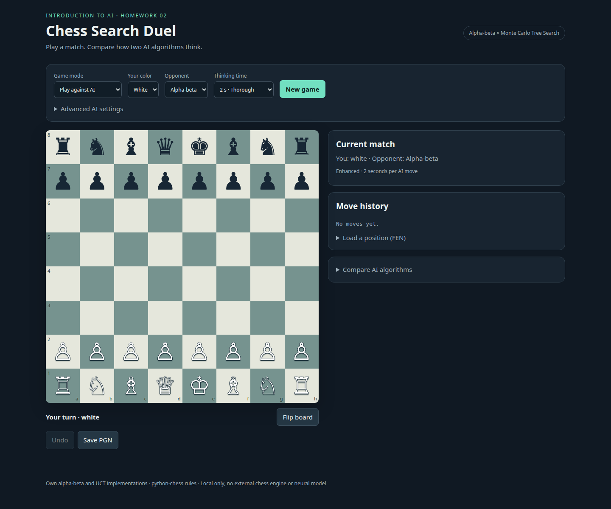

# Chess Alpha-beta and MCTS

A local chess application that lets you play against an AI, watch two AIs compete,
and compare their decisions on the same position. Built for **Introduction to
Artificial Intelligence, Homework 2 at HCMUT**.

The project implements Alpha-beta pruning and Monte Carlo Tree Search (MCTS)
itself. `python-chess` supplies legal moves, position history, game outcomes,
and PGN handling. There is no external chess engine or neural model.



## Quick start

You need **Python 3.10 or newer** and a modern browser. The project has been
tested on Python 3.14. It uses plain HTML, CSS and JavaScript with a small
Python HTTP server; no frontend build or Node.js installation is required.

```bash
git clone https://github.com/datduongabc/chess-alpha-beta-and-mcts.git
cd chess-alpha-beta-and-mcts
python -m venv .venv
```

Activate the environment on Linux, macOS or WSL:

```bash
source .venv/bin/activate
```

Or in Windows PowerShell:

```powershell
.\.venv\Scripts\Activate.ps1
```

Then install the dependencies and start the app:

```bash
python -m pip install -r requirements.txt
python -m chess_duel.app
```

Open **http://127.0.0.1:8765**. Stop the server with `Ctrl+C`.
If the port is occupied, run `python -m chess_duel.app --port 8766` instead.
The application listens only on the local machine and works offline after
its Python dependencies have been installed.

## What you can do

- **Play against AI:** choose your color and either algorithm. The AI responds
  automatically; Undo takes back your move and the AI reply.
- **Watch AI vs AI:** set the White and Black algorithms in Advanced AI settings,
  then start, pause or step through the match.
- **Two players / explore:** move pieces manually or load a FEN position.
- **Compare AI algorithms:** analyze the current position without changing it.
  Inspect suggested moves, Alpha-beta's best line, and MCTS visit statistics.
- Export a game as PGN or save a comparison as JSON.

Thinking time is a **per-move budget for each AI**. Choosing 5 seconds gives
Alpha-beta up to 5 seconds for its move and MCTS up to 5 seconds for its move.
A proven mate can finish earlier. Comparisons run sequentially to avoid
competing for CPU time.

The UI is in English. The simulator automatically claims available
threefold-repetition and fifty-move draws. Loading a FEN starts a new
repetition history because FEN does not contain previous moves.

## The algorithms

| Algorithm | Baseline | Enhanced |
|---|---|---|
| Alpha-beta | Negamax with pruning, move ordering and iterative deepening | Richer evaluation and quiescence, capped at six additional plies |
| MCTS | Adversarial UCT with random expansion and up to 40 random rollout plies | Guided 12-ply rollouts, 15% random rollout moves, richer evaluation and an exact immediate-mate guard |

The enhanced MCTS guard returns a proven mate in one directly. Otherwise it
screens root moves for an immediate opposing mate and excludes those moves
when an alternative exists. Its work uses the same thinking budget. An
interrupted scan does not apply a partial filter. UCT handles the remaining
search; the baseline remains available without this guard.

Both algorithms use the same evaluator in the selected UI variant.
Alpha-beta scores and MCTS utility have different units. MCTS utility is a
sampled heuristic value, **not a calibrated probability of winning**.

## Experiments and results

The repository includes raw measurements, configurations, source hashes,
independently checked diagnostic answers, and legal PGN game records.
The [English report](docs/report.pdf) explains the methods and their limits.

| Study | Included measurements |
|---|---|
| Earlier extended study | 360 searches, certified attack/defense cases, and 20 color-swapped games |
| Follow-up ablations | 912 searches across 24 mixed diagnostic positions and nine configurations |
| Follow-up games | 16 color-swapped games from the same four starts at 0.1 and 0.5 seconds per move |

The ablations separate evaluation, quiescence, rollout policy, rollout length,
and immediate-mate screening. The added diagnostics cover exchanges, an
undefended queen capture, and promotion as well as bounded mate objectives.

In the follow-up games, Alpha-beta scored **81.25% at 0.1 seconds** and
**87.5% at 0.5 seconds**; all 16 games ended naturally. These are results on
four selected starts, not Elo ratings or evidence of general engine strength.
For new runs, a nonterminal game reaching its ply cap is recorded as
**unfinished (`*`)**, not a draw. Analysis reports unfinished counts separately.

Rebuild the analysis from the included data without rerunning searches:

```bash
python -m benchmarks.analyze_results
python -m benchmarks.followup_experiments --analyze-only
python -m benchmarks.analyze_results --followup-games results/followup/games-matched
```

Run new experiments serially, away from active GUI searches:

```bash
# Basic position comparison, using the current engine.
python -m benchmarks.experiments --budgets 0.1 0.5 1 --seeds 5 --out runs/positions

# Controlled ablations; fixed budgets of 0.1 and 0.5 seconds.
python -m benchmarks.followup_experiments --out runs/ablation

# Same four starts and swapped colors at both budgets.
python -m benchmarks.experiments --mode games --positions fixtures/followup_game_starts.json --budgets 0.1 0.5 --game-starts 4 --max-plies 120 --out runs/games
python -m benchmarks.analyze_results --followup-games runs/games
```

New runs default to timestamped directories under ignored `runs/`. Bundled
fixtures and default analysis inputs resolve from the repository, independently
of the working directory. Explicit `--positions`, `--out`, `--results` and
`--followup-games` paths remain relative to the invoking directory.
Every new experiment output directory must be new. Repeating an RNG seed does
not make a wall-clock-limited search identical across hardware or CPU loads.
The earlier extended study uses the preserved implementation in
`results/extended/source/`; the follow-up sources and inputs are preserved in
`results/followup/source/`. Analyses check the archived source hashes without
executing those historical files. New runs record repository-relative source paths.
`results/sample/` and `results/enhanced/` contain separately labelled,
earlier exploratory runs. Excluded pilots and new scratch runs are gitignored.

## Tests

```bash
python -m unittest discover -s tests -v
```

The 31 tests cover pruning agreement with unpruned minimax, tactical choices,
MCTS selection and seed repeatability, history preservation, cancellation,
legal moves, special chess moves, HTTP validation, diagnostic answers and
unfinished-game scoring, path resolution and archived-source mismatch rejection.
HTTP tests use a temporary local port.
Python 3.14 may print a dependency deprecation warning; it does not fail the tests.

## Project structure

| Path | Purpose |
|---|---|
| `chess_duel/engine.py` | Evaluation, Alpha-beta, quiescence, UCT MCTS and tactical guard |
| `chess_duel/app.py` / `chess_duel/index.html` | Local API and browser interface |
| `benchmarks/experiments.py` | Serial position comparisons and color-swapped games |
| `benchmarks/followup_experiments.py` | Controlled ablation runner |
| `benchmarks/analyze_results.py` | Earlier-study and follow-up game analysis |
| `fixtures/` | Four disclosed JSON experiment inputs |
| `tests/` | Correctness, integration, path and provenance tests |
| `results/sample/`, `results/enhanced/` | Earlier exploratory measurements |
| `results/extended/`, `results/followup/` | Completed studies and frozen provenance |
| `runs/` | Ignored output from new experiments |
| `docs/` | PDF, editable LaTeX, screenshots, template assets and group information |

## Report and team

- [Report PDF](docs/report.pdf)
- [Editable LaTeX source](docs/report.tex)
- [Eight-member team and workload](docs/GROUP.md)
- [Assignment specification](homework_2_spec.md)
- [Submission packaging instructions](docs/SUBMISSION.md)

To rebuild the report, install a LaTeX distribution with Vietnamese T5 fonts
and `pgfplots`, then run from `docs/`:

```bash
pdflatex -interaction=nonstopmode -halt-on-error report.tex
pdflatex -interaction=nonstopmode -halt-on-error report.tex
```

The second pass updates the contents and references. The app itself does not
require LaTeX. Git tracks the finished PDF, report sources and template assets;
LaTeX intermediates and submission ZIPs stay local.

## Scope and acknowledgements

This is an educational comparison of two modest heuristic engines.
Finite depth and rollout horizons remain; a bounded diagnostic failure does
not establish that a move loses the full game. Constructed cases, color
mirrors and repeated seeds are correlated, and the test set is small.
There is no opening book, transposition table, neural model, Elo estimate,
online multiplayer or hosted deployment.

The locally supplied Chess, chessmc and Chess-engine repositories informed
the design study. Their source code, images and model weights were not copied.
Dependency and HCMUT report-template attribution, together with their licence
texts, are documented in [THIRD_PARTY_NOTICES.md](THIRD_PARTY_NOTICES.md).
